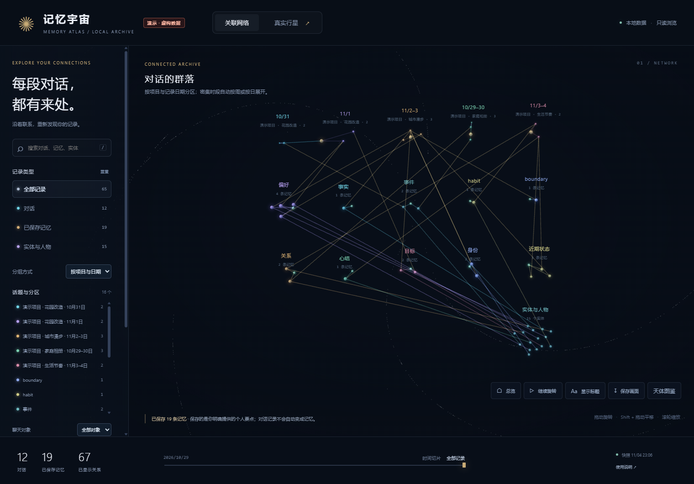
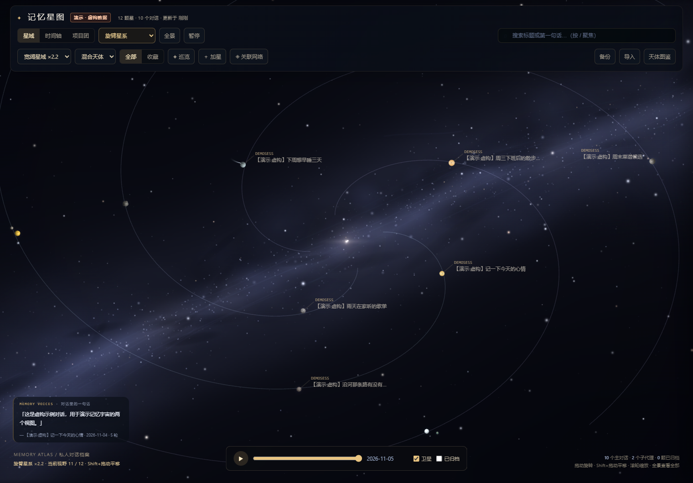

# human-memory · 类人脑记忆与记忆宇宙

**第二版 · 预览版 v0.6.0a2**

给 AI 装一套像人脑的记忆：**重要的记牢，日常的会淡，被提到才想起，可手动抢救。**

Python 只用标准库，数据保存在本机的 SQLite 文件中。附带一个「记忆宇宙」技能：把对话与记忆导出成两个可离线打开的三维视图——关联网络与真实行星。

> Human-memory is a local, dependency-free memory engine for AI assistants, plus a "memory universe" skill that renders your conversations and memories as two offline 3D views.

---


## 第二版更新（2026-11-04）

- **八类天体**：经典行星、带环行星、冰封星球、熔岩星球、海洋星球、恒星、小行星、彗星；可逐星切换，收藏、标签和外观可备份导入。
- **星域与视角**：四旋臂银河、银河天幕、立体环绕、同心轨道、宽阔/完整全景与双排工具栏。
- **操作补齐**：两个视图均支持 Shift + 左键拖动平移；网络支持节点标题显隐与保存 PNG。
- **关联网络**：项目/日期分组与内容话题分组；内容连线明确标为推测，可查看原文依据并忽略单条关系。没有内容关联输入的普通快照默认按项目/日期展示。
- **DSH 原生适配器**：随仓库提供真实/虚构模式切换、会话定位、手动保存与取消保存、内容索引、iframe 判源及 GPU 生命周期修复。适配器需要手工接入 DSH，不会随 demo 自动安装。

下载：[第二版 Release](https://github.com/zyj52742-cloud/human-memory/releases/tag/v0.6.0a2)。便携技能见 `skills/memory-universe/`；DSH 适配器与准备命令见 [integrations/dsh/README.md](integrations/dsh/README.md)。

## 先跑一个虚构 demo（不需要真实数据）

需要 Python 3.10+，不需要安装任何包：

```powershell
git clone https://github.com/zyj52742-cloud/human-memory.git
cd human-memory

python skills/memory-universe/scripts/universe.py demo
python skills/memory-universe/scripts/universe.py open
```

会生成 `skills/memory-universe/demo/`，里面有两页：

- `01-记忆宇宙.html`：对话 / 记忆 / 实体 / 来源关系的三维网络；
- `02-记忆星图.html`：每颗行星是一段对话，卫星是派生会话。

demo 的所有内容都是**合成示例**：品牌区有「演示 · 虚构数据」短标识，每条记忆带「【演示·虚构】」前缀。它不会读取或写入 `~/.human-memory/memory.db`，也不会联网。

本页截图均由上述虚构 demo 生成，包含 12 段对话、19 条记忆和 67 条关系。





---

## 项目组成

| 部分 | 位置 | 作用 |
|---|---|---|
| 记忆引擎 | 仓库根目录 `memory_core.py` / `scoring.py` / `extractor.py` | 存储、打分、衰减、召回、情绪轨迹；供 CLI、技能与 MCP 使用 |
| `memory` 技能 | `skills/memory/` | 让宿主 AI 在合适时机调用 `remember` / `recall`；复制到技能的安装目录即可 |
| `memory-universe` 技能 | `skills/memory-universe/` | 两个三维视图 + 便携 CLI；整个目录复制走即可独立使用 |
| MCP 服务 | 根目录 `mcp_server.py` | 给 Claude Desktop / Cursor 等 MCP 客户端提供 14 个工具 |

关系很简单：**引擎是唯一的数据层，技能和 MCP 都只是入口**。默认库位置按顺序决定：① `MEMORY_DB` 环境变量；② 源码目录下存在 `data/` 时用 `data/memory.db`（例如跑过 `selftest.py` 会创建它）；③ 都没有时用 `~/.human-memory/memory.db`。为避免“数据到底写哪了”的歧义，建议用 `MEMORY_DB` 显式固定一个路径。

需要说明：技能是否被自动触发、是否每轮都 recall，取决于宿主 AI 的技能选择机制。本仓库不承诺“每轮自动想起”。

---

## 日常用法

### 1. 命令行

```powershell
python memcli.py add "我讨厌香菜，闻到就想吐"
python memcli.py recall "晚饭吃什么"
python memcli.py mood
python memcli.py list
python memcli.py explain 3
```

### 2. 作为 AI 技能

把 `skills/memory/` 复制到你的 AI 工具的技能目录（各客户端的 skills 目录位置不同，按其文档放置）。技能内的命令使用相对路径，不绑定某个用户的本机目录。

### 3. 作为 MCP 服务

```json
{
  "mcpServers": {
    "human-memory": {
      "command": "python",
      "args": ["<绝对路径>/mcp_server.py"]
    }
  }
}
```

提供 14 个工具：remember / recall / list / pin / sleep / wake / stats / alias / explain / mood / update / delete / resolve / export。

### 4. 记忆宇宙

```powershell
# 虚构 demo
python skills/memory-universe/scripts/universe.py demo

# 导出自己的真实数据（只读，不修改数据库）
python skills/memory-universe/scripts/universe.py export `
  --db "C:\Users\你\.human-memory\memory.db" `
  --stars "C:\你的星图快照\_lib\data.js" `
  --output "C:\Users\你\Desktop\记忆宇宙导出"
```

`--db` 与 `--stars` 都可重复；只给 `--db` 时行星页为空、网络页仍显示记忆。更细的说明见 [skills/memory-universe/SKILL.md](skills/memory-universe/SKILL.md)。

---

## 隐私与离线边界

- **数据只在本机**：记忆库是本地 SQLite 文件，没有账号、没有云同步、没有遥测。
- **“默认离线”的范围**：`memory-universe` 的 `demo` / `export` / 两个视图不发网络请求；它的 `remember` / `recall` 默认屏蔽 `MEMORY_LLM_*` 环境变量。页面只加载本地 `_lib/` 资源，不用 CDN。
- **旧入口仍遵循原项目行为**：仓库根目录的 `memcli.py`、`mcp_server.py` 和旧 `skills/memory/` 没有开关；只要 `MEMORY_LLM_BASE_URL` / `MEMORY_LLM_API_KEY` / `MEMORY_LLM_MODEL` 三个变量齐全，它们就会调用你配置的 OpenAI 兼容接口。没有配置这些变量时，它们同样只走本地规则版。
- **可选模型抽取的启用方式不同**：新 `memory-universe` 入口要显式加 `--enable-llm`（或设置 `MEMORY_ALLOW_LLM=1`），并且仍需要三个变量；旧入口不需要开关，三个变量齐全即启用。任何失败都会回退规则版。见 [references/optional-extraction.md](skills/memory-universe/references/optional-extraction.md)。
- **导出只读**：`export` 用 SQLite `mode=ro` + `PRAGMA query_only=1` 打开数据库，不建库、不迁移、不唤醒、不写回。
- **演示数据是虚构的**：仓库不提交任何真实用户数据库、截图或对话内容；`*.db` / `*.sqlite`、生成的 `network-data.js` / `data.js` 等都在 `.gitignore` 里。

---

## 支持范围

- Python **3.10+**；核心引擎与导出器只用标准库，无 pip 依赖。
- Windows / macOS / Linux 按设计可用；本次发布只在 **Windows + Python 3.14 + Chrome** 上实测，其他系统与版本未逐项实测。
- 两个视图需要支持 WebGL 的现代浏览器（Chrome / Edge / Firefox / Safari 近年版本）。
- 星图快照输入支持 `data.js`（`window.__STAR_DATA__`）与同结构 JSON；记忆库输入为 `human-memory` 自己生成的 SQLite。
- 便携技能使用星图 JSON/JS 快照或 human-memory SQLite，不扫描 DSH 会话。可选 DSH 适配器提供本地压缩会话扫描与内容索引，需要 Python 3.14+（标准库 zstd）及 Node.js 18+，详见适配器说明；不会自动安装依赖。

---

## 测试

本次第二版发布副本已验证：8 项 CLI 回归、38 项真实 WebGL 浏览器检查、23 项保存/取消与跨库隔离检查、15 项内容关联检查、7 项原始日志解析检查、16 项 HTTP/路径检查及 20 项语法检查。截图来自虚构 demo；本次未重新安装生产 DSH，也未重跑 30 分钟稳定性测试。


```powershell
python selftest.py                  # 引擎自测
python mcp_test.py                  # MCP 协议自测（建议先把 MEMORY_DB 指向临时库）
python -m unittest discover -s tests -v   # 记忆宇宙：demo / 只读导出 / profile 隔离 / 中文空格路径 / 独立运行
python bench.py                     # 可选：本机小规模性能自测
```

`bench.py` 的数字随机器、Python 版本和磁盘状态变化，仅用于本机对比，不作为性能承诺。

---

## 已知限制（诚实说明）

1. **抽取是规则版**：靠情绪词表、自我参照、句式与词频，识别不了很隐晦的表达（例如“说不上来哪里不对”）。
2. **权重是经验先验**：七因子权重有心理学依据的排序，但没有拿大规模真实对话调过参；`tune.py` 可做自动调参。
3. **不做复杂的记忆冲突推理**：只做“同对象 + 态度反转 → 旧的标记为被取代”，不做时效推理。
4. **中文按 2-gram 切词**：单字情绪词已特殊处理，但跨词表达仍可能漏召回。
5. **“类人脑”是设计隐喻**：指分层、休眠、线索唤醒、手动抢救这些机制；不是经过科学验证的人脑模拟，也没有效果学承诺。
6. **不会自动跨轮召回**：是否调用、何时调用取决于宿主 AI。
7. **可选模型抽取**：新 `memory-universe` 入口默认关闭；旧根 CLI / MCP / 旧技能是原项目行为——三个 `MEMORY_LLM_*` 变量齐全就启用。在 8 GB 显存机器上试过本地小模型，输出质量不稳定，因此没有把它设为默认。
8. **便携快照是只读浏览**。DSH 内的真实记录页另有明确的保存/取消保存操作，需要原生适配器；虚构 demo 始终只读。禁用 WebGL 的浏览器可能显示异常。

---

## 目录

```text
human-memory/
├── memory_core.py          引擎：存储、状态机、召回、情绪分析、迁移、导入导出
├── scoring.py              评分：情绪词库、七因子、类型、衰减、心结
├── extractor.py            抽取层：规则版 / 可选模型版（默认关闭）
├── memcli.py               命令行入口
├── mcp_server.py           MCP 服务（14 工具）
├── chat_play.py            交互式体验
├── selftest.py             引擎自测
├── mcp_test.py             MCP 协议验收
├── bench.py                本机小规模性能自测
├── tune.py                 召回参数自动调优
├── skills/
│   ├── memory/             日常记忆技能
│   └── memory-universe/    记忆宇宙技能（两个视图 + 便携 CLI）
├── integrations/dsh/       可选 DSH 原生适配器与准备命令
├── tests/
│   └── test_universe.py    记忆宇宙回归测试
├── ARCHITECTURE.md         架构说明
├── TUTORIAL.md             上手教程
├── THIRD_PARTY_NOTICES.md  第三方组件与素材来源
└── LICENSE                 MIT
```

## 许可

MIT。第三方组件（Three.js 等）的版权与许可见 [THIRD_PARTY_NOTICES.md](THIRD_PARTY_NOTICES.md)。
